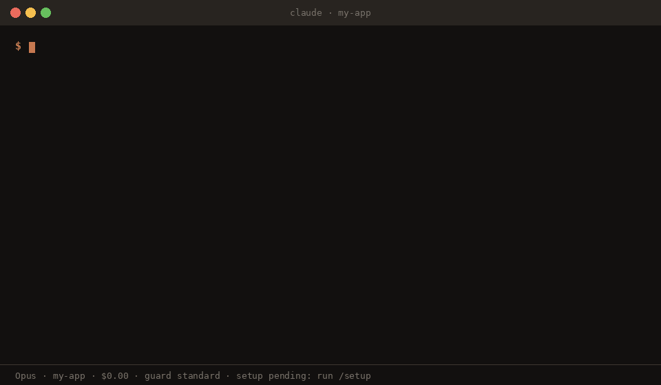

<div align="center">

# Claude Code Project Kit

### Make Claude Code actually know your project, in five minutes.

One command, and Claude reads your repo, asks a few multiple-choice questions, and writes the whole setup for you:
`CLAUDE.md`, rules, permissions, hooks, skills, agents and MCP servers, all matched to your real stack.

[](https://github.com/John99101/claude-code-project-template/actions/workflows/ci.yml)
[](CHANGELOG.md)
[](LICENSE)
[](https://docs.claude.com/en/docs/claude-code)
[](.github/workflows/ci.yml)
[](https://m8ven.ai/mcp/john99101-claude-code-project-template-1leowc?s=readme)



<sub>Illustrative session. Every message from the kit in it is the hooks' real output.</sub>

```text
/plugin install cct --marketplace John99101/claude-code-project-template
/cct:setup
```

[Quick start](#quick-start) · [What you get](#what-you-get) · [A day with the kit](#a-day-with-the-kit) · [FAQ](#faq) · [Full guide](docs/GUIDE.md)

</div>

---

## Why

Out of the box, Claude Code doesn't know how your tests run, which folders are generated, what your team's commit style is, or that it must never touch `.env`. So it guesses, and you correct it over and over.

Claude Code can learn all of this through `CLAUDE.md`, rules, settings, hooks, skills, agents and MCP. Setting them up by hand takes hours per project, is easy to get wrong, and goes stale. **This kit does it for you, and keeps it current.**

| Without the kit | With the kit |
|---|---|
| Claude guesses `npm test` while your repo uses `pnpm vitest` | `CLAUDE.md` lists the real commands, detected from `package.json`, `Makefile` and CI |
| "Done!" … and the tests fail | The **done gate** runs your checks before Claude finishes, and only the tests related to the change |
| Lint errors show up in CI an hour later | Every edited file is **formatted and linted**, and problems go straight back to Claude |
| One `rm -rf` or force-push away from a bad day | A **guard** blocks destructive commands and secret-file edits, and asks before risky ones |
| Claude installs a package whose name it made up | The **dependency check** blocks names that don't exist on npm, PyPI or crates.io, and asks before brand-new ones |
| "All tests pass!" … but nothing ran | The **claim check** sends Claude back when it claims a check it never ran |
| "Don't touch the API" is forgotten after compaction | **`/pin`** keeps it in Claude's context and the guard enforces path pins |
| Claude rewrites a helper you already have | **Duplicate hints** point it to the existing function |
| Cursor, Copilot and Claude follow different instructions | **One `AGENTS.md`** feeds every tool; generated copies can't drift |
| Commands and hooks break for the Windows half of the team | The **portability check** flags POSIX-only commands, backslash paths and CRLF scripts |
| Claude makes a failing test pass by skipping it | The **test guard** asks before skips, deleted tests, removed assertions or changed expected values |
| Database + web browsing + `curl` in one session: one poisoned page away from a leak | The **trifecta check** warns about the combination and asks before data leaves the machine |
| A 2,000-line change nobody can review | The **small-batch nudge** says when to commit, before it gets that big |
| A teammate changes the rules and nobody notices | **Session notices** flag teammates' config changes, stale installs, missing `.env` keys and outdated commands |
| Every new repo starts from zero | Your answers are **remembered**, so the next project only asks what's new |

## Quick start

**Plugin** (easiest). In Claude Code:

```text
/plugin install cct --marketplace John99101/claude-code-project-template
```

Then run **`/cct:setup`** in any project. Updates arrive through `/plugin`. On older Claude Code versions, add the marketplace first with `/plugin marketplace add John99101/claude-code-project-template`, then `/plugin install cct@cct-kit`.

<details>
<summary><b>Other ways to install: into one repo for your team, device-wide, or as a new repo</b></summary>

**Ask Claude.** In Claude Code, inside your project:

```text
Install github.com/John99101/claude-code-project-template into this project, following its INSTALL.md
```

Claude previews the install, applies it, then walks you through setup. The config lives in the repo, so your whole team shares it.

**Install script.**

```bash
git clone --depth 1 https://github.com/John99101/claude-code-project-template /tmp/cct
python3 /tmp/cct/install.py --project ~/code/my-app   # one project, shared with your team via git
python3 /tmp/cct/install.py --global                  # every project on this device
```

On Windows, in PowerShell: `.\install.ps1 --project C:\code\my-app` (or `py -3 install.py …`). Add `--dry-run` to preview. Existing files are never overwritten, and `settings.json` is merged with a backup. Then run **`/setup`** in Claude Code (or `/setup --defaults` to skip the questions).

**New repository.** Click **Use this template**, run `python3 install.py --adopt` once, restart Claude Code and run `/setup`.

| | Plugin | Project install | Device install |
|---|---|---|---|
| Commands | `/cct:setup`, `/cct:pr`… | `/setup`, `/pr`… | `/setup`, `/pr`… |
| Shared with your team | Optional | Yes, committed to git | No |
| Updates | `/plugin` | `/template-update` | `/template-update` |

`--update` pulls kit updates and keeps your changes; `--uninstall` removes the kit but keeps files you changed.

</details>

> **Requirements:** Claude Code and Python 3.8+ (the hooks use only the standard library). Tested on every push on **Linux, macOS and Windows**.

## What setup looks like

*Illustrative run on a TypeScript API:*

```text
[cct]   The Claude Code kit is installed here, but setup isn't finished. Run /setup to finish it.

You     /setup
Claude  Found: TypeScript + Fastify, pnpm, Vitest, ESLint + Prettier, Postgres, Conventional Commits.
        ? How thorough should setup be?          › Quick (recommended)
        ? How independently should I work?       › Ask before big or risky changes (recommended)
        ? What must pass before I say I'm done?  › pnpm lint, pnpm typecheck, pnpm test
        ? Run those automatically when I finish? › Yes, the fast checks, only related tests
        ? Connect any tools via MCP?             › GitHub, Postgres

        Plan: CLAUDE.md (stack, 7 commands, architecture) · 5 rules + typescript.md
              settings: allow pnpm test/lint/typecheck · .mcp.json: GitHub, Postgres
        Apply? › Apply

Claude  PASS  pnpm lint (2.1 s) · PASS  pnpm typecheck (4.0 s) · PASS  pnpm vitest related (1.3 s)
        Done. Set GITHUB_PERSONAL_ACCESS_TOKEN and DATABASE_URI, then restart Claude Code.
```

Quick setup asks about a dozen questions; Thorough asks about 30. Monorepos get a short brief per package. See the [full walkthrough](docs/GUIDE.md#6-a-full-example).

## What you get

**A project brief Claude reads every session.** `CLAUDE.md` with your stack, real commands, architecture, conventions and a "before you say it's done" checklist. Topic rules (code style, testing, API design, security, git) and language packs for Python, TypeScript, Go, Rust and Java/Kotlin load only for matching files.

**Commands for the whole workflow**

| Command | What it does |
|---|---|
| `/start-issue 123` | Reads the GitHub or GitLab issue, creates a branch in your naming style, finds the code involved and proposes a plan |
| `/check` | Lint, type check and tests, then fixes what recent changes broke |
| `/review-changes` | Reviews your diff with a reviewer agent (and a security auditor when it matters) |
| `/commit` | Commits in your project's message style |
| `/pr` | Opens a review-ready pull request: suggests a split when it's too big, ticks only checks that really ran, and tells the reviewer its assumptions, what's untested and where to look first |
| `/handoff` | Saves where a task stands, so tomorrow's session (`/handoff resume`) picks up exactly there |
| `/pin` | Pins a constraint for the task ("don't change the public API", `only edit: src/billing/**`). It survives compaction, and path pins are enforced |
| `/spec` | Writes a short behaviour spec (examples, acceptance criteria, non-goals) for your OK before any code, then builds and checks against it |
| `/tidy` | Proposes small cleanups for the code you just changed, each tested and committed apart from feature work |
| `/learn on` | Learning mode: Claude explains concepts, lets you guess a bug's cause first, and leaves small parts for you to write |
| `/setup` | Re-tunes anything later: "make the guard strict", "add a rule for our GraphQL conventions" |

Claude also picks up `write-tests`, `debug-issue`, `release-notes` and `remember-preference` by itself when they fit, and has four specialist agents: planner, reviewer, security auditor and test writer.

**Hooks that enforce, not suggest**

- **Guard:** blocks `rm -rf ~`, `curl … | sh`, force-pushes to `main` and writes to `.env` or keys, even when they're hidden in `sh -c`, `eval` or `$(…)`. It asks before `git reset --hard`, `sudo`, `DROP TABLE` and publishing.
- **Format and lint on every edit** with the tools your project already has (prettier, biome, eslint, ruff, black, gofmt, golangci-lint, rustfmt, clippy, shellcheck). It never downloads anything.
- **Done gate:** your checks run before Claude finishes a turn that changed files; a failure sends Claude back to fix it.
- **Dependency check:** before an install, every package is looked up in its registry. Names that don't exist are blocked (AI models invent package names, and attackers register them); packages under 30 days old or barely downloaded need your OK. New imports that no manifest declares are pointed out too.
- **Test guard:** edits that add `skip` markers, delete test cases, remove assertions or only change an expected value need your OK, so Claude can't make a test pass by weakening it.
- **Trifecta check:** when MCP servers and permissions give Claude private data, untrusted content *and* a way to send data out (Simon Willison's "lethal trifecta"), you're warned, and outbound commands such as `curl -d` need your OK.
- **Small-batch nudge:** past 300 uncommitted lines (lockfiles and generated files excluded), you're told to commit the finished part.
- **Claim check:** if Claude's final reply says "tests pass" or "verified" but no check ran in that turn, it's sent back to run it or correct the claim.
- **Duplicate hints:** a new function that already exists elsewhere (`formatDate` / `format_date`) is pointed out, so Claude reuses it.
- **Status line:** `Opus · my-app (main) · $0.42 · guard standard · setup done`.

**Session notices.** At session start you see what needs attention before Claude touches anything:

```text
[cct] This machine doesn't quite match the project:
- pnpm-lock.yaml changed since the last install. Run `pnpm install`.
- .env is missing STRIPE_KEY (listed in .env.example).
- Node 20 is required (.nvmrc), but `node` is 18.19.1.
[cct] Teammates (Alex) changed the Claude config since your last session: .claude/rules/testing.md.
[cct] There's a handoff note from 2026-11-27 18:05 in .claude-handoff.md. Run /handoff resume to pick up where you left off.
```

It also flags commands in `CLAUDE.md` that no longer exist, linters your project configures but you haven't installed, instruction files for other AI tools that disagree with `AGENTS.md`, and, for teams with Windows, commands, hooks and scripts that won't work there.

## A day with the kit

```text
/start-issue 482        → branch feat/482-rate-limit, plan, your OK
… Claude works …        → every edit formatted and linted; the done gate runs related tests
/review-changes         → reviewer and security auditor read the diff
/commit  →  /pr         → PR opened from your template, test plan filled in
/handoff                → end of day; tomorrow: /handoff resume
```

## Built on research

Several features answer specific findings about AI-assisted coding:

| Finding | What the kit does |
|---|---|
| Experienced developers were 19% slower with AI but believed they were 20% faster ([METR](https://metr.org/blog/2025-07-10-early-2025-ai-experienced-os-dev-study/)) | Done gate, claim check and the session cost in the status line replace gut feeling with evidence |
| Agents disable or delete tests to get a green run ([Kent Beck](https://tidyfirst.substack.com/p/augmented-coding-beyond-the-vibes)) | Test guard |
| Private data + untrusted content + outbound access enables prompt-injection leaks ([Simon Willison](https://simonwillison.net/2025/Jun/16/the-lethal-trifecta/)) | Trifecta check |
| Model reliability drops as context grows ([Chroma](https://research.trychroma.com/context-rot)) | `/pin` and `/handoff` keep what matters outside the conversation |
| Developers who let AI write the code learned less, especially debugging ([Anthropic](https://www.anthropic.com/research/AI-assistance-coding-skills)) | `/learn` |
| Spec-first workflows give humans and agents one source of truth ([Böckeler, Thoughtworks](https://www.martinfowler.com/articles/exploring-gen-ai/sdd-3-tools.html)) | `/spec` |
| AI raises delivery speed but lowers stability; small batches help ([DORA 2025](https://services.google.com/fh/files/misc/2025_state_of_ai_assisted_software_development.pdf)) | Small-batch nudge, `/pr` size check |
| Refactoring fell and copy-paste rose with AI adoption ([GitClear](https://www.gitclear.com/ai_assistant_code_quality_2025_research)) | Duplicate hints, `/tidy` |
| AI models invent package names that attackers then register ([Socket](https://socket.dev/glossary/slopsquatting), [CSA](https://labs.cloudsecurityalliance.org/research/csa-research-note-slopsquatting-ai-supply-chain-20260419-csa/)) | Dependency check |

## Your credits, under control

Anything that makes Claude do extra work is capped, and everything that's just information costs nothing:

- **Lint feedback** stops for a file after 3 reports in a row (`lint_max_repeats`), so Claude never loops on a linter it can't satisfy.
- **The done gate** gives up after 3 tries per turn, and runs only the tests related to the change.
- **Notices** are shown to you, not sent to Claude, so they use no tokens.
- **The status line** shows the session's cost as you go.

## FAQ

**Does it work with my stack?** Setup detects Node (npm, pnpm, yarn, bun), Python (uv, poetry, pip), Go, Rust, Java/Kotlin and more, plus monorepos (pnpm, Turborepo, Nx, Cargo and Go workspaces). Anything it can't detect, it asks about.

**Will it overwrite my existing `CLAUDE.md` or settings?** No. Existing files are never overwritten; setup merges into them and asks before dropping anything you wrote. `settings.json` is merged with a backup.

**Can my team share it?** Yes. A project install lives in the repo, so everyone gets the same rules, guard and commands. Personal tweaks go in `CLAUDE.local.md` and `settings.local.json`, which stay out of git.

**Does it work alongside other plugins?** Yes. As a plugin, its commands are namespaced (`/cct:…`). See [using it with other plugins](docs/GUIDE.md#10-using-the-kit-with-other-plugins-eg-ecc).

**Does it update itself?** No, on purpose: the hooks run code on your machine, so new code only arrives when you choose. Plugin installs update through `/plugin`. Script installs use `/template-update` and can opt in to a weekly "new version" notice.

**Can I turn things off?** Every hook has a switch in `.claude/cct.json`. See the [configuration reference](docs/GUIDE.md#8-configuration-reference).

## How it's tested

| Check | When |
|---|---|
| [Test suite](tests/test_kit.py): every hook, the installer, updates, uninstall, the plugin and file formats | Every push, on Linux, macOS and Windows |
| [Setup eval](tests/eval_setup.py) runs `/setup` for real on four sample projects; the [question eval](tests/eval_questions.py) checks the questions it would ask | Weekly on GitHub, or any time locally ([how](docs/GUIDE.md#running-the-setup-eval)) |
| [MCP catalog check](scripts/check_mcp_catalog.py): every server URL and package still exists | Weekly; opens an issue if something breaks |

<details>
<summary><b>Repository layout</b></summary>

The repository uses Claude Code's standard plugin layout. The plugin uses these folders directly; the installer copies them into a project's `.claude/`.

```text
.
├── .claude-plugin/        # plugin manifest, marketplace entry, icon
├── skills/                # setup, start-issue, check, review-changes, commit, pr, handoff, template-update,
│                          # remember-preference, write-tests, debug-issue, release-notes
├── agents/                # planner, reviewer, security-auditor, test-writer
├── hooks/                 # guard, file protection, format and lint, done gate, session notices, status line
├── rules/                 # code-style, testing, api-design, security, git-workflow
├── rule-packs/            # python, typescript, go, rust, java
├── templates/             # CLAUDE.md templates, settings, cct.json, mcp.json
├── install.py             # install, update, adopt, uninstall (+ install.sh / install.ps1 launchers)
├── scripts/  tests/       # helpers, test suite, setup eval, sample projects
└── docs/GUIDE.md          # the in-depth guide
```

What a project gets after `install.py --project`:

```text
my-app/
├── CLAUDE.md              # project brief, filled in by /setup
├── .mcp.json              # MCP servers
└── .claude/
    ├── settings.json      # permissions, hooks, status line
    ├── cct.json           # kit switches
    ├── rules/  skills/  agents/  hooks/
    └── cct/               # rule packs, package template, install manifest
```

</details>

## Documentation

- **[Guide](docs/GUIDE.md):** how each part works, the setup flow, safety model, configuration, troubleshooting
- **[Hooks](hooks/README.md):** what each hook does and how to add your own
- **[INSTALL.md](INSTALL.md):** install instructions written for Claude
- **[Changelog](CHANGELOG.md)**

## Contributing

Issues and pull requests are welcome; see [CONTRIBUTING.md](CONTRIBUTING.md). Run the tests with `python3 tests/test_kit.py -v`.

If the kit saves you time, a ⭐ helps other developers find it.

## License

[MIT](LICENSE)
