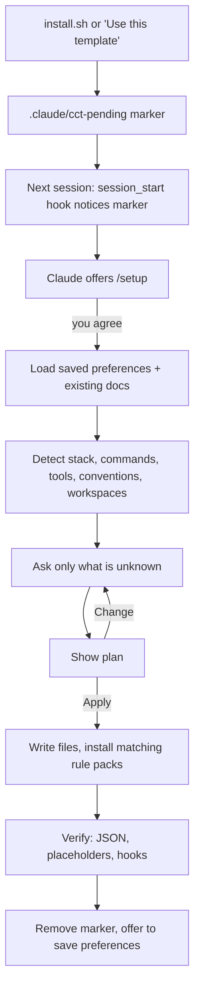

# The Claude Code Project Kit — Guide

This guide explains **why the kit exists, how each part works, and how to tune it**. For a quick start, see the [README](../README.md).

**Contents**
1. [Why this kit exists](#1-why-this-kit-exists)
2. [Who it's for](#2-who-its-for)
3. [How Claude Code reads its configuration](#3-how-claude-code-reads-its-configuration)
4. [The components, and why each one exists](#4-the-components-and-why-each-one-exists)
5. [The setup flow in detail](#5-the-setup-flow-in-detail)
6. [A full example](#6-a-full-example)
7. [The safety model](#7-the-safety-model)
8. [Configuration reference](#8-configuration-reference)
9. [Plugin, project and device installs](#9-plugin-project-and-device-installs)
10. [Using the kit with other plugins (e.g. ECC)](#10-using-the-kit-with-other-plugins-eg-ecc)
11. [Updating, customising and removing](#11-updating-customising-and-removing)
12. [How the kit is tested](#12-how-the-kit-is-tested)
13. [Troubleshooting](#13-troubleshooting)
14. [FAQ](#14-faq)

---

## 1. Why this kit exists

Claude Code works much better with good project context: which commands run the tests, what the conventions are, what it must never touch, which tools it can use. Claude Code supports all of this through `CLAUDE.md`, rules, settings, hooks, skills, agents and MCP servers. In practice, though:

- **Setting it up by hand is slow and repetitive.** Every project needs the same scaffolding, written again.
- **It's easy to get wrong.** One huge `CLAUDE.md` wastes context on every message; a missing permission rule means constant prompts; no guard means one bad command can wipe a folder.
- **It drifts.** Preferences you've explained ten times live in chat history, not in config.
- **It's inconsistent across projects and teammates.**

The kit fixes this by shipping a **complete, opinionated structure** plus a **setup wizard that Claude runs itself**. Claude reads the project, works out what it can, **asks you about the rest**, writes the config, and remembers your answers. Every project you set up afterwards gets faster.

## 2. Who it's for

| You are… | You get… |
|---|---|
| **A solo developer with many projects** | Install once on your device; every new project gets offered setup, reusing your saved preferences. |
| **A team** | Install into the repo; everyone shares the same rules, skills, agents, guards and MCP servers via git, and keeps personal overrides in git-ignored local files. |
| **Working in a monorepo** | A short brief per package instead of one giant file, with language rules scoped to the packages that use them. |
| **New to Claude Code** | A working, well-structured setup without learning every config format first. The files double as examples. |
| **Experienced** | A tested baseline you can trim or extend, with an installer that never overwrites your files and a clean uninstall. |

## 3. How Claude Code reads its configuration

Knowing *when* things load explains why the kit splits configuration the way it does.

| What | When it loads | Cost |
|---|---|---|
| `CLAUDE.md` (project), `~/.claude/CLAUDE.md` (personal) | Start of every session | Always in context, so keep it short |
| `<subfolder>/CLAUDE.md` | When Claude works in that folder | Only when relevant (used for monorepo packages) |
| `CLAUDE.local.md` | Start of every session, for you only | Always in context |
| `.claude/rules/*.md` without `paths:` | Start of every session | Always in context |
| `.claude/rules/*.md` with `paths:` | Only when Claude works on matching files | Only when relevant |
| Skills (`.claude/skills/*/SKILL.md`) | Only the name and description at start; the full text when invoked or when the task matches | Very light |
| Agents (`.claude/agents/*.md`) | When Claude delegates; each runs in its own context window | Keeps the main context clean |
| Hooks and status line (`settings.json`) | Run by Claude Code itself on events, outside the model | Zero context; enforced, not advisory |
| MCP servers (`.mcp.json`) | Connected at session start | Tool definitions in context |

**The key idea:** put *always-true, short* facts in `CLAUDE.md`, *topic detail* in rules (path-scoped where possible), *procedures* in skills, *specialist work* in agents, and *anything that must be guaranteed* in hooks. Instructions can be forgotten; hooks can't.

> **Commands are skills now.** Claude Code merged custom slash commands into skills: `.claude/skills/commit/SKILL.md` creates `/commit` exactly like `.claude/commands/commit.md` did. The kit uses skills for everything. Workflow skills you trigger yourself carry `disable-model-invocation: true`, so Claude never runs `/commit` on its own.

## 4. The components, and why each one exists

### `CLAUDE.md` — the project brief
Loaded every session. The template has sections for overview, tech stack, a **commands table** (install, run, test, lint, type check, format, build), architecture, conventions and working agreements. Setup fills it from your project and your answers, and deletes rows for commands that don't exist.

*Why a commands table?* It's the single most useful thing Claude can know. `/check`, the `write-tests` skill and the `test-writer` agent all read it, so it's defined once and used everywhere.

### `CLAUDE.local.md` — personal overrides
Your own notes for this project (local URLs, how you run the database), git-ignored. Copy `CLAUDE.local.md.example` to start.

### `.claude/rules/` — modular conventions

| Rule | Loads | Covers |
|---|---|---|
| `code-style.md` | Always | Formatter, linter, naming, structure, error handling |
| `testing.md` | Test files only | Framework, commands, approach, what makes a good test |
| `api-design.md` | API code only | Resource naming, status codes, validation, pagination, compatibility |
| `security.md` | Always | Secrets, untrusted input, dependencies, prompt-injection awareness |
| `git-workflow.md` | Always | Branches, commit style, PR policy, never pushing unasked |

Each rule has a **"Project specifics"** section that setup fills in, and an **"Always"** section with sensible defaults. Setup removes rules that don't apply, after asking.

### `rule-packs/` — ready-made language rules
Tested rules for **Python, TypeScript/JavaScript, Go, Rust and Java/Kotlin**: idioms, error handling, testing style and tooling. The installer stores them in `.claude/cct/rule-packs/`, where Claude Code doesn't load them. Setup copies only the ones your project uses into `.claude/rules/`, fills in the specifics (version, package manager, tools) and narrows the `paths:`. Using packs instead of writing rules from scratch keeps quality consistent between projects.

### `.claude/skills/` — slash commands and know-how

**You run these:**

| Skill | What it does |
|---|---|
| `/setup` | Runs the setup wizard. With no marker present it re-tunes: tell it what to change. `/setup --defaults` skips all questions. |
| `/check` | Lint → type check → tests, using the commands table. Summarises, then fixes failures caused by recent changes. |
| `/review-changes` | Pulls live `git status` and `git diff` into the prompt, runs the reviewer (and the security auditor when relevant) in parallel, and asks which findings to fix. |
| `/commit` | Shows live status and recent log, writes a message in the project's style, commits. Never pushes. |
| `/template-update` | Updates the kit from GitHub, keeping your customisations (see [§11](#11-updating-customising-and-removing)). |

**Claude uses these when the task fits:**

| Skill | Triggers when… |
|---|---|
| `setup` | A session notice says setup is pending, or you want to change how Claude works here |
| `remember-preference` | You say "always…", "never…", "from now on…", or correct the same thing twice. It saves the preference to the right file. |
| `write-tests` | You add a feature, fix a bug, or ask for tests |
| `debug-issue` | Something is broken and the cause isn't obvious. It enforces reproduce → hypothesise → fix the root cause → regression test. |
| `release-notes` | You're preparing a release |

Skills cost almost nothing until used: only their one-line description sits in context. Skills like `/commit` use `` !`command` `` to inject live shell output, so Claude starts with the real state instead of guessing.

### `.claude/agents/` — specialists with their own context

| Agent | Model | Access | Use for |
|---|---|---|---|
| `planner` | Opus | Read-only | Designing multi-file changes before touching code |
| `reviewer` | Inherits yours | Read-only + git | Reviewing a diff before commit |
| `security-auditor` | Inherits yours | Read-only + audit tools | Changes to auth, input handling, SQL, secrets, dependencies |
| `test-writer` | Sonnet | Read/write | Writing or fixing tests in bulk |

Agents run in a **separate context window**, so a long exploration or review doesn't fill up your main conversation. Setup can change their models to match your budget.

### `.claude/hooks/` — guarantees, not suggestions

| Hook | Event | Purpose |
|---|---|---|
| `session_start.py` | Session start | Tells Claude setup is unfinished, so it offers `/setup`. Silent otherwise. |
| `guard_bash.py` | Before every shell command | Blocks destructive commands, asks before risky ones (see [§7](#7-the-safety-model)) |
| `protect_files.py` | Before every file edit | Blocks edits to secrets and git internals; asks before lockfiles and CI |
| `format_file.py` | After every file edit | Formats the file with *your project's* formatter, then lints it. **Lint problems go straight back to Claude**, which fixes them before moving on instead of finding them later at `/check`. |
| `statusline.py` | Status line | `Opus · my-app (main) · guard standard · setup done` |

Hooks need only `python3` and the standard library. They never download anything, never break a session on bad input, and only use tools already in your project (`node_modules/.bin`, `.venv/bin`) or on your `PATH`.

### `.mcp.json` — external tools
Ships empty. During setup, Claude suggests servers that fit your stack: GitHub if your remote is GitHub, Postgres if you use Postgres, and so on. It adds the ones you pick from [`mcp-catalog.json`](../.claude/skills/setup/mcp-catalog.json), which is checked weekly so its entries stay current. **Credentials are always `${ENV_VAR}` references** or browser logins via `/mcp`, so the file is safe to commit and share.

### `.claude/settings.json` — permissions, hooks and status line
Pre-approves read-only git commands, asks before `git push`, denies reading `.env` and key files, and registers the hooks and status line. Setup adds the project's own safe commands (for example `Bash(npm run test:*)`) so you're not prompted for every test run. Personal overrides go in `.claude/settings.local.json` (git-ignored).

## 5. The setup flow in detail



**Detection** reads: package manifests and lockfiles (language, framework, package manager); test, lint, format and type-check configs; `Makefile`, `justfile` and `package.json` scripts (real commands); CI workflows (what must pass); Docker and ORM files (databases → MCP suggestions); workspace files (monorepos); the folder layout (architecture); git history (commit style, branch naming); and any existing `CLAUDE.md`, `AGENTS.md`, `.cursorrules` or Copilot instructions, which are merged, not discarded.

**Questions** come from a fixed [question bank](../.claude/skills/setup/questions.md), so they're consistent. Each round has at most four multiple-choice questions, with the recommended answer first and the detected facts quoted ("Found Jest and Vitest configs. Which is current?"). Anything detected or saved is *not* asked again; it's listed in the plan for you to confirm.

**Nothing is written before you approve the plan**, and nothing is committed. Your existing content is merged, never silently dropped.

**`/setup --defaults`** skips the questions and the approval step. It uses detected values, saved preferences, or the recommended answer, and lists every choice it made. It's useful for a quick start and is what the automated setup eval uses.

### Monorepos

Setup recognises pnpm, npm and yarn workspaces, Nx, Turborepo, Lerna, Cargo workspaces, `go.work` and uv workspaces. Because Claude Code loads a subfolder's `CLAUDE.md` when it works there, setup:

1. asks which packages to cover (apps and services pre-selected);
2. keeps the **root `CLAUDE.md`** for the overview, shared tooling, workspace-wide commands and a **package map** (path → purpose → language);
3. gives each chosen package a short **`<package>/CLAUDE.md`** from [`templates/CLAUDE.package.md`](../templates/CLAUDE.package.md), with its own commands (e.g. `pnpm --filter api test`) and dependencies;
4. scopes language rules to the packages that use them.

## 6. A full example

*Illustrative.* A TypeScript API, installed with `install.sh --project`, then opened in Claude Code:

> **Claude:** This project has the Claude Code kit installed, but setup isn't finished. Want me to run `/setup` now?
>
> **You:** yes
>
> **Claude:** *(reads package.json, pnpm-lock.yaml, vitest.config.ts, eslint.config.js, .prettierrc, .github/workflows/ci.yml, docker-compose.yml, git log)*
> I found: TypeScript + Fastify, pnpm, Vitest, ESLint + Prettier, Postgres in docker-compose, Conventional Commits in history. A few questions:
>
> 1. **How independently should I work?** → *Ask before big or risky changes (recommended)*
> 2. **How should tests be handled?** → *Write tests with every change (recommended)*
> 3. **Connect any tools via MCP?** (multi-select) → *GitHub*, *Postgres*
> 4. **Safety guard level?** → *Standard (recommended)*
>
> **Plan**
> - `CLAUDE.md`: overview, stack, commands (`pnpm i`, `pnpm dev`, `pnpm test`, `pnpm vitest run <file>`, `pnpm lint`, `pnpm typecheck`, `pnpm build`), architecture of `src/routes`, `src/services`, `src/db`
> - Rules: fill code-style (Prettier, ESLint, camelCase), testing (`paths: src/**/*.test.ts`), api-design (`paths: src/routes/**`), git-workflow (Conventional Commits, feature branches); install the `typescript.md` pack
> - `settings.json`: allow `pnpm test`, `pnpm lint`, `pnpm typecheck`
> - `.mcp.json`: GitHub (`GITHUB_PERSONAL_ACCESS_TOKEN`), Postgres (`DATABASE_URI`, read-only mode)
>
> Apply? → **Apply**
>
> **Claude:** Done. All JSON is valid, no placeholders are left, and the hooks respond correctly. Set `GITHUB_PERSONAL_ACCESS_TOKEN` and `DATABASE_URI`, then restart Claude Code to load the new hooks and MCP servers. Save your general answers for future projects? → **Yes**

The next project only gets asked project-specific questions.

## 7. The safety model

The guard sorts shell commands and file edits into three outcomes:

| Outcome | Meaning | Examples |
|---|---|---|
| **Deny** | Blocked outright; Claude is told why | `rm -rf /`, `~` or `*`; `find / -delete`; `mkfs`; `dd` to a disk; fork bombs; `curl … \| sh`; force-pushing or deleting `main`/`master` on the remote; editing `.env`, keys, `secrets/`, `.git/` |
| **Ask** | You confirm in the permission prompt | `rm -r <dir>`; `find … -delete` or `-exec rm`; `git reset --hard`; `git clean -f`; force-pushing or deleting other branches; `sudo`; `DROP`/`TRUNCATE`; publishing packages; reading `.env`; editing lockfiles or CI workflows |
| **Allow** | Normal permission rules apply | Everything else |

The guard reads commands the way a shell does. It understands quotes (so `git commit -m "fix rm -rf / bug"` is fine), splits chains like `a && b | c`, and **looks inside nested commands**: `sh -c '…'`, `bash -c "…"`, `eval …`, `$(…)` and backticks. So `bash -c "rm -rf ~"` is blocked just like `rm -rf ~`.

`guard_level: "strict"` additionally asks before `git push`, adding dependencies and any `rm`. `"off"` disables both guards (not recommended).

**It's a safety net, not a sandbox.** It catches common accidents and obvious destructive patterns, but a deliberately obfuscated command (base64-decoded, built from variables, written to a script first) can get past pattern matching. For untrusted code or long unattended runs, also turn on **Claude Code's built-in sandbox** (`/sandbox`), which isolates the filesystem and network at the operating-system level. The two work well together: the guard explains *why* something is blocked, and the sandbox makes sure anything missed can't do damage.

## 8. Configuration reference

**`.claude/cct.json`** (project) and **`~/.claude/cct.json`** (device). Project values win.

| Key | Default | Values |
|---|---|---|
| `guard_level` | `"standard"` | `"off"`, `"standard"`, `"strict"` |
| `format_on_edit` | `true` | Format files after Claude edits them |
| `lint_on_edit` | `true` | Lint files after Claude edits them and send problems back to Claude |
| `protect_lockfiles` | `true` | Ask before hand-editing lockfiles |
| `setup_reminder` | `true` | Session-start reminder when setup is pending |

To turn off the status line, remove `statusLine` from `settings.json` (or answer "No" during setup).

**Files the kit creates**

| File | Purpose |
|---|---|
| `.claude/cct-pending` | Marker: setup not finished. Deleted by setup. |
| `.claude/cct-ignore` | Device installs: don't offer setup in this project |
| `.claude/cct/source.json` | Kit repo, version, commit and install date |
| `.claude/cct/manifest.txt` | SHA-256 of every file as installed, used by `/template-update` and `--uninstall` |
| `.claude/cct/rule-packs/` | Language rules setup can install |
| `.claude/cct/CLAUDE.package.md` | Template for monorepo package briefs |
| `.claude/cct/CLAUDE.template.md` | The kit's template, saved when you already had a `CLAUDE.md` |
| `~/.claude/cct-preferences.md` | Your saved answers, reused across projects. Edit freely. |

## 9. Plugin, project and device installs

| | Plugin | Project (`--project`) | Device script (`--global`) |
|---|---|---|---|
| Install | `/plugin install cct --marketplace John99101/claude-code-project-template` | `install.sh --project <dir>` | `install.sh --global` |
| Lives in | Claude Code's plugin cache | `<project>/.claude/`, `CLAUDE.md`, `.mcp.json` | `~/.claude/` (hooks in `~/.claude/hooks/cct/`) |
| Commands | `/cct:setup`, `/cct:commit`, `/cct:check`… | `/setup`, `/commit`, `/check`… | `/setup`, `/commit`, `/check`… |
| Shared via git | Optional (see below) | Yes | No |
| Updates | `/plugin` | `/template-update` | `/template-update` |
| Remove | `/plugin uninstall cct@cct-kit` | `install.sh --project <dir> --uninstall` | `install.sh --global --uninstall` |
| Status line | Not possible: plugins can only set `agent` and `subagentStatusLine` | Yes | Yes |
| Best for | Your personal toolkit in every project | Teams, or projects that need specific config | Personal use when you want plain files you can edit |

**What setup writes in each case:** the plugin provides the skills, agents and hooks. `/cct:setup` still writes the project's `CLAUDE.md` and `.claude/rules/`, because plugins can't ship rules or project context.

**Enabling the plugin for a whole team:** add this to the project's `.claude/settings.json`, and everyone who opens the repo gets the plugin offered:

```json
{
  "extraKnownMarketplaces": {
    "cct-kit": { "source": { "source": "github", "repo": "John99101/claude-code-project-template" } }
  },
  "enabledPlugins": { "cct@cct-kit": true }
}
```

**Combining installs:** hooks never run twice. A project's own copy wins, then the device copy, then the plugin. **Skills are different:** Claude Code gives *personal* skills priority over *project* skills with the same name, so with a device script install, `/setup` and `/commit` run the device copies even in a project with its own customised ones. Plugin skills are namespaced and never clash, which is why the plugin is the better choice for device-wide use.

### Repos created with "Use this template"

A repo created from GitHub's template button gets a copy of the whole kit repository, including the kit's own tests, CI and release workflows, changelog and license. On the first `/setup`, Claude detects this and offers `install.sh --adopt`, which:

- moves the language rules and package template into `.claude/cct/`, where setup expects them;
- records a manifest, so `/template-update` and `--uninstall` work later;
- removes the kit's development files and replaces the README with a stub for your project.

It refuses to run in the kit's own repository.

## 10. Using the kit with other plugins (e.g. ECC)

Whether installed by script or as the `cct` plugin, the kit works alongside other plugins such as **Everything Claude Code (ECC)**. A few things to know when combining them:

| Area | What happens | Recommendation |
|---|---|---|
| **Names** | Plugin skills and agents are namespaced (`/ecc:code-review`, `ecc:code-reviewer`), the kit's aren't (`/review-changes`, `reviewer`). Nothing collides. | Nothing to do. If you prefer a plugin's version of something, delete the kit's file. |
| **Overlapping agents** | Claude may see two code reviewers (the kit's `reviewer` and a plugin's). `/review-changes` always uses the kit's. | Keep both, or remove one so Claude doesn't have to choose. |
| **Safety hooks** | Hooks from all sources run, and the strictest decision wins: if either the kit's guard or a plugin's hook blocks a command, it's blocked. | Fine to keep both. If both ask about the same thing, lower one of them (`guard_level`, or the plugin's own switches). |
| **ECC GateGuard** | GateGuard asks Claude to state facts (purpose, callers, your instruction) before creating each new file or running destructive commands. That's separate from the kit's guard and doesn't conflict, but it adds a round trip per new file, which makes `/setup` slower. | During setup, consider running with `ECC_GATEGUARD=off`, or exempt kit paths with `GATEGUARD_EXEMPT_GLOBS`. |
| **Formatting** | If a plugin also formats files after edits, files get formatted twice (harmless, just slower). | Set `format_on_edit: false` in `cct.json` if you prefer the plugin's formatter. Keep `lint_on_edit` on, since the kit sends lint errors back to Claude. |
| **Status line** | Only one status line can be active. The installer never replaces an existing one. | Pick the one you like in `settings.json`. |
| **Setup commands** | The kit's `/setup` and a plugin's own configuration command (e.g. `/ecc:configure-ecc`) are separate and configure different things. | Run each for its own part. |

## 11. Updating, customising and removing

**Customise freely.** Everything installed is plain Markdown, JSON or Python in your repo. Edit rules, delete agents, add skills. `/setup` can make changes for you too: "make the guard strict", "add a rule for our GraphQL conventions".

**Update** with `/template-update`. It fetches the latest kit, shows the changelog since your installed version, and compares each file against the hash recorded at install:
- unchanged by you and changed upstream → updated automatically;
- changed by you and changed upstream → shows both diffs and asks;
- new upstream → listed for you to accept;
- removed upstream (e.g. 1.0's `commands/`, now skills) → offered for deletion if you haven't changed them.

Nothing is written before you confirm.

**Remove** with the installer:

```bash
bash install.sh --project ~/code/my-app --uninstall --dry-run   # preview
bash install.sh --project ~/code/my-app --uninstall             # or: --global --uninstall
```

It deletes every kit file you haven't changed, **keeps and lists the ones you have** (like your filled-in `CLAUDE.md`), takes the kit's hooks and status line out of `settings.json` (with a backup), and leaves your permission rules and `.gitignore` lines alone.

## 12. How the kit is tested

| Check | What it covers | When |
|---|---|---|
| [`tests/test_kit.py`](../tests/test_kit.py) | Every guard rule (including the loopholes above), file protection, lint feedback, status line, device/project de-duplication, settings merge and removal, install, uninstall, file formats | Every push and pull request, on Linux and macOS |
| [`tests/eval_setup.py`](../tests/eval_setup.py) | Runs `/setup --defaults` **for real** on four sample projects in [`tests/fixtures/`](../tests/fixtures) (Python, TypeScript, Go, pnpm monorepo) and checks: marker removed, no placeholders left, valid JSON, the right commands in `CLAUDE.md`, the right rule packs, package briefs in the monorepo, guard still working | Weekly and on demand, when the repo has an `ANTHROPIC_API_KEY` secret. Uses API credits (roughly $0.30–1 per project on Sonnet). |
| [`scripts/check_mcp_catalog.py`](../scripts/check_mcp_catalog.py) | Every MCP catalog URL still answers, and every npm/PyPI package still exists and isn't deprecated | Weekly; opens a GitHub issue if something broke |
| Release workflow | Tag matches `VERSION`, tests pass, release notes come from `CHANGELOG.md` | On every `v*` tag |

To run the setup eval yourself: `python3 tests/eval_setup.py python-app --keep` (keeps the result folder so you can inspect it).

## 13. Troubleshooting

| Symptom | Fix |
|---|---|
| `/setup` asks permission for every file in `.claude/` | That's Claude Code protecting its own config folder, and it happens even in auto-accept mode. Choose "allow for this session" at the first prompt. |
| Claude never offers setup | Restart Claude Code after installing; hooks load at session start. Check that `.claude/cct-pending` exists and `python3` is on your `PATH`. Or just run `/setup`. |
| `/setup` or other skills don't appear | Restart Claude Code. Check the files are in `.claude/skills/` (project) or `~/.claude/skills/` (device). |
| A hook error appears on every tool call | Run the hook by hand: `echo '{"tool_input":{"command":"ls"}}' \| python3 .claude/hooks/guard_bash.py`. The usual cause is `python3` missing. |
| The guard blocks something you need | Run the command yourself in a terminal, or lower `guard_level` in `.claude/cct.json`. |
| Files aren't formatted or linted | The hook only uses tools already installed in the project or on `PATH`, and ESLint only runs when the project has an ESLint config. Install the tool, or turn the step off in `cct.json`. |
| Claude keeps getting lint messages it can't fix | The linter's own config may disagree with the project. Fix the config, or set `lint_on_edit: false`. |
| An MCP server fails to connect | Check the env vars are set in the shell that starts Claude Code, run `/mcp` (some servers need a browser login there), and check the vendor docs. |
| Setup is very slow with many confirmations | Another plugin may be adding a step per file (see [§10](#10-using-the-kit-with-other-plugins-eg-ecc)). |

## 14. FAQ

**Does the kit send any data anywhere?**
No. The hooks and installer run locally and make no network calls. MCP servers you choose to add connect to their own services. The setup eval and catalog check run only in the kit's own CI, or when you start them.

**Will it overwrite my existing `CLAUDE.md` or settings?**
No. The installer never overwrites files. `settings.json` is *merged*, adding only missing entries, with a backup. Setup merges into your `CLAUDE.md` and asks before removing anything.

**Can I use it with other Claude Code plugins?**
Yes. See [§10](#10-using-the-kit-with-other-plugins-eg-ecc).

**Why Python for hooks?**
It's on almost every developer machine, handles JSON safely, and works the same on Linux and macOS. Shell plus `jq` would add a dependency and be harder to test.

**What does Claude do with `~/.claude/cct-preferences.md`?**
It reads it at setup to skip questions you've already answered, and writes to it only after asking. It holds general preferences only, never project details.

**Why aren't the commands in `.claude/commands/` any more?**
Claude Code merged commands into skills, and skills can do more (supporting files, auto-loading, manual-only mode). The slash command names didn't change. `/template-update` offers to remove the old files from 1.0 installs.
