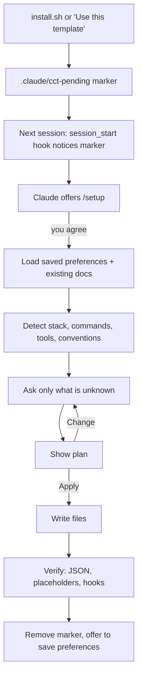

# The Claude Code Project Kit — Guide

This guide explains **why the kit exists, how each part works, and how to tune it**. For a quick start, see the [README](../README.md).

**Contents**
1. [Why this kit exists](#1-why-this-kit-exists)
2. [Who it's for](#2-who-its-for)
3. [How Claude Code reads its configuration](#3-how-claude-code-reads-its-configuration)
4. [The components, and why each one exists](#4-the-components-and-why-each-one-exists)
5. [The setup flow in detail](#5-the-setup-flow-in-detail)
6. [A full example](#6-a-full-example)
7. [The safety model](#7-the-safety-model)
8. [Configuration reference](#8-configuration-reference)
9. [Project vs device installs](#9-project-vs-device-installs)
10. [Updating, customising and removing](#10-updating-customising-and-removing)
11. [Troubleshooting](#11-troubleshooting)
12. [FAQ](#12-faq)

---

## 1. Why this kit exists

Claude Code works much better with good project context: which commands run the tests, what the conventions are, what it must never touch, which tools it can use. Claude Code supports all of this through `CLAUDE.md`, rules, settings, hooks, skills, agents and MCP servers. In practice, though:

- **Setting it up by hand is slow and repetitive.** Every project needs the same scaffolding, written again.
- **It's easy to get wrong.** One huge `CLAUDE.md` wastes context on every message; a missing permission rule means constant prompts; no guard means one bad command can wipe a folder.
- **It drifts.** Preferences you've explained ten times live in chat history, not in config.
- **It's inconsistent across projects and teammates.**

The kit fixes this by shipping a **complete, opinionated structure** plus a **setup wizard that Claude runs itself**. Claude reads the project, works out what it can, **asks you about the rest**, writes the config, and remembers your answers. Every project you set up afterwards gets faster.

## 2. Who it's for

| You are… | You get… |
|---|---|
| **A solo developer with many projects** | Install once on your device; every new project gets offered setup, reusing your saved preferences. |
| **A team** | Install into the repo; everyone shares the same rules, commands, agents, guards and MCP servers via git, and keeps personal overrides in git-ignored local files. |
| **New to Claude Code** | A working, well-structured setup without learning every config format first. The files double as examples. |
| **Experienced** | A tested baseline you can trim or extend, with an installer that never overwrites your files. |

## 3. How Claude Code reads its configuration

Knowing *when* things load explains why the kit splits configuration the way it does.

| What | When it loads | Cost |
|---|---|---|
| `CLAUDE.md` (project), `~/.claude/CLAUDE.md` (personal) | Start of every session | Always in context, so keep it short |
| `CLAUDE.local.md` | Start of every session, for you only | Always in context |
| `.claude/rules/*.md` without `paths:` | Start of every session | Always in context |
| `.claude/rules/*.md` with `paths:` | Only when Claude works on matching files | Only when relevant |
| Skills (`.claude/skills/*/SKILL.md`) | Only the name and description at start; the full text when the task matches | Very light |
| Commands (`.claude/commands/*.md`) | When you type `/name` | Zero until used |
| Agents (`.claude/agents/*.md`) | When Claude delegates; each runs in its own context window | Keeps the main context clean |
| Hooks (`settings.json`) | Run by Claude Code itself on events, outside the model | Zero context; enforced, not advisory |
| MCP servers (`.mcp.json`) | Connected at session start | Tool definitions in context |

**The key idea:** put *always-true, short* facts in `CLAUDE.md`, *topic detail* in rules (path-scoped where possible), *procedures* in skills and commands, *specialist work* in agents, and *anything that must be guaranteed* in hooks. Instructions can be forgotten; hooks can't.

## 4. The components, and why each one exists

### `CLAUDE.md` — the project brief
Loaded every session. The template has sections for overview, tech stack, a **commands table** (install, run, test, lint, type check, format, build), architecture, conventions and working agreements. Setup fills it from your project and your answers, and deletes rows for commands that don't exist.

*Why a commands table?* It's the single most useful thing Claude can know. `/check`, the `write-tests` skill and the `test-writer` agent all read it, so it's defined once and used everywhere.

### `CLAUDE.local.md` — personal overrides
Your own notes for this project (local URLs, how you run the database), git-ignored. Copy `CLAUDE.local.md.example` to start.

### `.claude/rules/` — modular conventions

| Rule | Loads | Covers |
|---|---|---|
| `code-style.md` | Always | Formatter, linter, naming, structure, error handling |
| `testing.md` | Test files only | Framework, commands, approach, what makes a good test |
| `api-design.md` | API code only | Resource naming, status codes, validation, pagination, compatibility |
| `security.md` | Always | Secrets, untrusted input, dependencies, prompt-injection awareness |
| `git-workflow.md` | Always | Branches, commit style, PR policy, never pushing unasked |

Each rule has a **"Project specifics"** section that setup fills in, and an **"Always"** section with sensible defaults. Setup also adds a **language rule** (for example `python.md` for `**/*.py`) for the stack it detects, and removes rules that don't apply, after asking.

### `.claude/commands/` — repeatable workflows

| Command | What it does |
|---|---|
| `/setup` | Runs the setup wizard. With no marker present it re-tunes: tell it what to change. |
| `/check` | Lint → type check → tests, using the commands table. Summarises, then fixes failures caused by recent changes. |
| `/review-changes` | Pulls live `git status` and `git diff` into the prompt, runs the reviewer (and the security auditor when relevant) in parallel, and asks which findings to fix. |
| `/commit` | Shows live status and recent log, writes a message in the project's style, commits. Never pushes. |
| `/template-update` | Updates the kit from GitHub, keeping your customisations (see [§10](#10-updating-customising-and-removing)). |

Commands use the `` !`command` `` syntax to inject live shell output, so Claude starts with the real state instead of guessing.

### `.claude/skills/` — know-how that loads on demand

| Skill | Triggers when… |
|---|---|
| `project-setup` | Setup is pending, you run `/setup`, or you want to change how Claude works here |
| `remember-preference` | You say "always…", "never…", "from now on…", or correct the same thing twice. It saves the preference to the right file. |
| `write-tests` | You add a feature, fix a bug, or ask for tests |
| `debug-issue` | Something is broken and the cause isn't obvious. It enforces reproduce → hypothesise → fix the root cause → regression test. |
| `release-notes` | You're preparing a release |

Skills cost almost nothing until used: only their one-line description sits in context.

### `.claude/agents/` — specialists with their own context

| Agent | Model | Access | Use for |
|---|---|---|---|
| `planner` | Opus | Read-only | Designing multi-file changes before touching code |
| `reviewer` | Inherits yours | Read-only + git | Reviewing a diff before commit |
| `security-auditor` | Inherits yours | Read-only + audit tools | Changes to auth, input handling, SQL, secrets, dependencies |
| `test-writer` | Sonnet | Read/write | Writing or fixing tests in bulk |

Agents run in a **separate context window**, so a long exploration or review doesn't fill up your main conversation. Setup can change their models to match your budget.

### `.claude/hooks/` — guarantees, not suggestions

| Hook | Event | Purpose |
|---|---|---|
| `session_start.py` | Session start | Tells Claude setup is unfinished, so it offers `/setup`. Silent otherwise. |
| `guard_bash.py` | Before every shell command | Blocks destructive commands, asks before risky ones (see [§7](#7-the-safety-model)) |
| `protect_files.py` | Before every file edit | Blocks edits to secrets and git internals; asks before lockfiles and CI |
| `format_file.py` | After every file edit | Formats the file with *your project's* formatter, if installed |

Hooks need only `python3` and the standard library. They never download anything and never break a session on bad input.

### `.mcp.json` — external tools
Ships empty. During setup, Claude suggests servers that fit your stack: GitHub if your remote is GitHub, Postgres if you use Postgres, and so on. It adds the ones you pick from [`mcp-catalog.json`](../.claude/skills/project-setup/mcp-catalog.json). **Credentials are always `${ENV_VAR}` references**, so the file is safe to commit and share.

### `.claude/settings.json` — permissions and hooks
Pre-approves read-only git commands, asks before `git push`, denies reading `.env` and key files, and registers the hooks. Setup adds the project's own safe commands (for example `Bash(npm run test:*)`) so you're not prompted for every test run. Personal overrides go in `.claude/settings.local.json` (git-ignored).

## 5. The setup flow in detail

**Detection** reads: package manifests and lockfiles (language, framework, package manager); test, lint, format and type-check configs; `Makefile`, `justfile` and `package.json` scripts (real commands); CI workflows (what must pass); Docker and ORM files (databases → MCP suggestions); the folder layout (architecture); git history (commit style, branch naming); and any existing `CLAUDE.md`, `AGENTS.md`, `.cursorrules` or Copilot instructions, which are merged, not discarded.

**Questions** come from a fixed [question bank](../.claude/skills/project-setup/questions.md), so they're consistent. Each round has at most four multiple-choice questions, with the recommended answer first and the detected facts quoted ("Found Jest and Vitest configs. Which is current?"). Anything detected or saved is *not* asked again; it's listed in the plan for you to confirm.

**Nothing is written before you approve the plan**, and nothing is committed. Your existing content is merged, never silently dropped.

## 6. A full example

*Illustrative.* A TypeScript API, installed with `install.sh --project`, then opened in Claude Code:

> **Claude:** This project has the Claude Code kit installed, but setup isn't finished. Want me to run `/setup` now?
>
> **You:** yes
>
> **Claude:** *(reads package.json, pnpm-lock.yaml, vitest.config.ts, eslint.config.js, .prettierrc, .github/workflows/ci.yml, docker-compose.yml, git log)*
> I found: TypeScript + Fastify, pnpm, Vitest, ESLint + Prettier, Postgres in docker-compose, Conventional Commits in history. A few questions:
>
> 1. **How independently should I work?** → *Ask before big or risky changes (recommended)*
> 2. **How should tests be handled?** → *Write tests with every change (recommended)*
> 3. **Connect any tools via MCP?** (multi-select) → *GitHub*, *Postgres*
> 4. **Safety guard level?** → *Standard (recommended)*
>
> **Plan**
> - `CLAUDE.md`: overview, stack, commands (`pnpm i`, `pnpm dev`, `pnpm test`, `pnpm vitest run <file>`, `pnpm lint`, `pnpm typecheck`, `pnpm build`), architecture of `src/routes`, `src/services`, `src/db`
> - Rules: fill code-style (Prettier, ESLint, camelCase), testing (`paths: src/**/*.test.ts`), api-design (`paths: src/routes/**`), git-workflow (Conventional Commits, feature branches); add `typescript.md`
> - `settings.json`: allow `pnpm test`, `pnpm lint`, `pnpm typecheck`
> - `.mcp.json`: GitHub (`GITHUB_PERSONAL_ACCESS_TOKEN`), Postgres (`DATABASE_URL`, use a read-only user)
>
> Apply? → **Apply**
>
> **Claude:** Done. All JSON is valid, no placeholders are left, and the hooks respond correctly. Set `GITHUB_PERSONAL_ACCESS_TOKEN` and `DATABASE_URL`, then restart Claude Code to load the new hooks and MCP servers. Save your general answers for future projects? → **Yes**

The next project only gets asked project-specific questions.

## 7. The safety model

The guard sorts shell commands and file edits into three outcomes:

| Outcome | Meaning | Examples |
|---|---|---|
| **Deny** | Blocked outright; Claude is told why | `rm -rf /`, `~` or `*`; `mkfs`; `dd` to a disk; fork bombs; `curl … \| sh`; force-push to `main`/`master`; editing `.env`, keys, `secrets/`, `.git/` |
| **Ask** | You confirm in the permission prompt | `rm -r <dir>`; `git reset --hard`; `git clean -f`; force-push to other branches; `sudo`; `DROP`/`TRUNCATE`; publishing packages; reading `.env`; editing lockfiles or CI workflows |
| **Allow** | Normal permission rules apply | Everything else |

`guard_level: "strict"` additionally asks before `git push`, adding dependencies and any `rm`. `"off"` disables both guards (not recommended).

The guard is a **safety net, not a sandbox**. It catches common accidents and obvious destructive patterns; a determined, obfuscated command can get past pattern matching. Combine it with Claude Code's permission modes and review prompts for anything sensitive.

## 8. Configuration reference

**`.claude/cct.json`** (project) and **`~/.claude/cct.json`** (device). Project values win.

| Key | Default | Values |
|---|---|---|
| `guard_level` | `"standard"` | `"off"`, `"standard"`, `"strict"` |
| `format_on_edit` | `true` | Format files after Claude edits them |
| `protect_lockfiles` | `true` | Ask before hand-editing lockfiles |
| `setup_reminder` | `true` | Session-start reminder when setup is pending |

**Files the kit creates**

| File | Purpose |
|---|---|
| `.claude/cct-pending` | Marker: setup not finished. Deleted by setup. |
| `.claude/cct-ignore` | Device installs: don't offer setup in this project |
| `.claude/cct/source.json` | Where and when the kit was installed from |
| `.claude/cct/manifest.txt` | SHA-256 of every file as installed, used by `/template-update` |
| `.claude/cct/CLAUDE.template.md` | The kit's template, saved when you already had a `CLAUDE.md` |
| `~/.claude/cct-preferences.md` | Your saved answers, reused across projects. Edit freely. |

## 9. Project vs device installs

| | Project (`--project`) | Device (`--global`) |
|---|---|---|
| Installs into | `<project>/.claude/`, `CLAUDE.md`, `.mcp.json` | `~/.claude/` (hooks in `~/.claude/hooks/cct/`) |
| Shared via git | Yes | No |
| Setup | Once per project | Once for your preferences; then every project without a `CLAUDE.md` gets offered setup once |
| Best for | Teams, or projects that need specific config | Your personal defaults everywhere |

**Using both:** device install for your personal rules and preferences, project install for team-shared config. Claude Code merges them, with project settings taking precedence. When a project has its own copy of the hooks, the device's setup reminder stays quiet to avoid duplicates.

## 10. Updating, customising and removing

**Customise freely.** Everything installed is plain Markdown, JSON or Python in your repo. Edit rules, delete agents, add commands. `/setup` can make changes for you too: "make the guard strict", "add a rule for our GraphQL conventions".

**Update** with `/template-update`. It fetches the latest kit and compares each file against the hash recorded at install:
- unchanged by you and changed upstream → updated automatically;
- changed by you and changed upstream → shows both diffs and asks;
- new upstream → listed for you to accept.

Nothing is written before you confirm.

**Remove:** delete the files listed in `.claude/cct/manifest.txt` and the hook entries that point to `.claude/hooks/*.py` (or `~/.claude/hooks/cct/`) in `settings.json`. A backup of your previous `settings.json` sits next to it as `settings.json.bak-<timestamp>`.

## 11. Troubleshooting

| Symptom | Fix |
|---|---|
| Claude never offers setup | Restart Claude Code after installing; hooks load at session start. Check that `.claude/cct-pending` exists and `python3` is on your `PATH`. Or just run `/setup`. |
| `/setup` or other commands don't appear | Restart Claude Code. Check the files are in `.claude/commands/` (project) or `~/.claude/commands/` (device). |
| A hook error appears on every tool call | Run the hook by hand: `echo '{"tool_input":{"command":"ls"}}' \| python3 .claude/hooks/guard_bash.py`. The usual cause is `python3` missing. |
| The guard blocks something you need | Run the command yourself in a terminal, or lower `guard_level` in `.claude/cct.json`. |
| Files aren't formatted | The hook only uses formatters already installed in the project (`node_modules/.bin`, `.venv/bin`) or on `PATH`. Install the formatter, or set `format_on_edit: false`. |
| An MCP server fails to connect | Check the env vars are set in the shell that starts Claude Code, run `/mcp`, and check the vendor docs (catalog entries can go stale). |
| Hooks run twice | You have both a device and a project install, and both register the guards. Remove one set from `~/.claude/settings.json`. |

## 12. FAQ

**Does the kit send any data anywhere?**
No. The hooks and installer run locally and make no network calls. MCP servers you choose to add connect to their own services.

**Will it overwrite my existing `CLAUDE.md` or settings?**
No. The installer never overwrites files. `settings.json` is *merged*, adding only missing entries, with a backup. Setup merges into your `CLAUDE.md` and asks before removing anything.

**Can I use it with other Claude Code plugins?**
Yes. The kit uses plain project and user config, not the plugin system, so it coexists with plugins. If a plugin ships similar hooks, you may want only one set.

**Why Python for hooks?**
It's on almost every developer machine, handles JSON safely, and works the same on Linux and macOS. Shell plus `jq` would add a dependency and be harder to test.

**What does Claude do with `~/.claude/cct-preferences.md`?**
It reads it at setup to skip questions you've already answered, and writes to it only after asking. It holds general preferences only, never project details.
